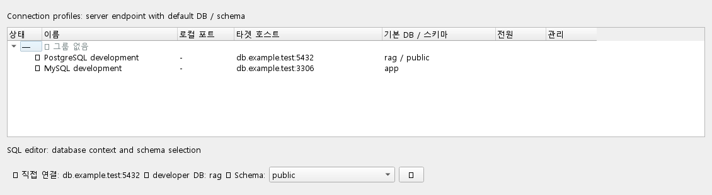

# PostgreSQL 연결 목록의 DB와 스키마

연결 목록의 한 항목은 DB 서버에 접속하는 연결 프로필이다. 직접 연결은
대상 호스트/포트, SSH 연결은 Bastion을 거쳐 대상 호스트/포트로 전달하는
터널을 관리한다. PostgreSQL 데이터베이스마다 터널을 만들 필요는 없다.
같은 서버에 계정이나 기본 DB가 다른 프로필을 저장하는 것도 가능하다.

프로필의 `기본 DB 이름`과 `기본 스키마`는 SQL 편집기 등에서 사용할
접속 기본값이다. 연결 목록은 `기본 DB / 스키마` 열에 PostgreSQL의
`rag / public`처럼 표시한다. 미설정 시 SQL 편집기와 같은 기본값인
`postgres / public`을 표시한다. MySQL은 DB 이름만 표시한다.

SQL 편집기는 `DB: rag`와 `Schema: public`을 함께 표시한다. PostgreSQL의
Schema 선택과 새로고침은 현재 DB 안의 스키마만 조회한다. `CREATE DATABASE`는
현재 접속 DB를 바꾸지 않는다. 다른 DB를 사용하려면 미커밋 작업을 정리하고
연결 설정의 `기본 DB 이름`을 변경한 뒤 SQL 편집기를 다시 연다.

이번 변경은 연결 대상 표시와 안내 문구를 개선한다. 서버 전체 DB 탐색과
편집기 내 DB 전환은 추가하지 않는다. 후속으로 추가할 경우 기존의
미커밋 변경 및 운영 환경 읽기 전용 보호를 유지해야 한다.

아래 이미지는 실제 위젯을 테스트용 연결 정보로 렌더링한 미리보기다.
실제 서버 연결이나 배포 앱 실행을 증명하는 이미지는 아니다.

